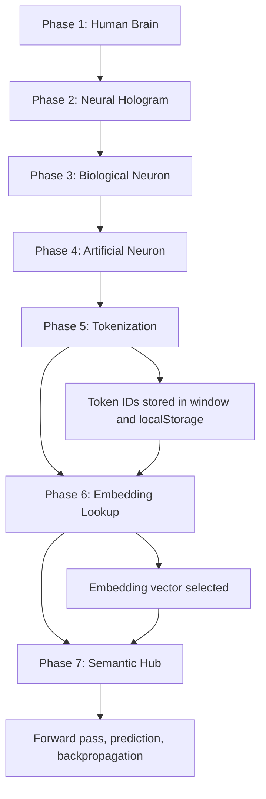

# Artificial Neuron Project

An interactive browser-based learning experience that explains how biological neurons inspired artificial neural networks, and how modern language-model style processing moves from text to tokens, embeddings, prediction, and backpropagation.

The project is designed as a cinematic, phase-by-phase visual journey. It starts with the human brain, moves into neural-network structure, explains a biological neuron, demonstrates an artificial neuron, then continues into tokenization, embedding lookup, and a full semantic neural-network hub. The goal is to make difficult AI concepts feel visible, connected, and easier to understand.

## Project Idea

Artificial intelligence can feel abstract because most of its work happens inside numbers, vectors, weights, and hidden layers. This project turns that hidden process into an interactive visual story.

The central idea is to show the relationship between:

- A human brain and biological neurons.
- A digital neural network made of connected nodes.
- An artificial neuron that receives inputs, applies weights, adds bias, and fires based on a threshold.
- Tokenization, where text is converted into token IDs.
- Embeddings, where token IDs become dense numeric vectors.
- A neural-network prediction system that performs forward pass and backpropagation.

Instead of explaining AI only through static text, the project uses 3D models, animated signals, particles, matrix visuals, glassmorphism panels, and guided narration. Each phase builds on the previous one so the viewer can understand the complete pipeline from biology to machine learning.

## Live Experience Flow

The project is controlled through keyboard navigation:

- Right arrow or Space: move to the next phase.
- Left arrow: move to the previous phase.
- R: restart from the first phase.

The page is intentionally structured like a presentation, but it behaves like an interactive web experience. Each phase has its own visual system and animation logic.

## Phases Explained

### Phase 1: Human Brain

The opening phase shows a glowing 3D particle brain. It introduces the brain as the central biological inspiration behind neural networks.

What this phase explains:

- The brain is the control unit of the nervous system.
- It contains billions of neurons.
- Information moves through electrical and chemical signals.
- Neurons form large networks that create thought, memory, perception, and action.

Technical implementation:

- `xyz/y.js` creates the 3D brain using Three.js.
- The brain is built as a particle cloud using `THREE.BufferGeometry`.
- A mathematical surface function generates a brain-like shape.
- Thousands of points are sampled and colored to form a glowing neural structure.
- The background star field is rendered with the Canvas 2D API.
- GSAP is used for the opening reveal and transition effects.

### Phase 2: Neural Network Hologram

The second phase transforms the biological idea into a digital neural network. It presents a large holographic network made of connected nodes.

What this phase explains:

- Neural networks are built from layers of connected nodes.
- Data flows through weighted connections.
- A network learns by adjusting these weights over time.
- Parallel processing allows many signals to move through the system together.

Technical implementation:

- `xyz/y.js` creates the hologram scene.
- Three.js renders multiple layers of neuron-like nodes.
- `THREE.InstancedMesh` is used to render many repeated nodes efficiently.
- Connection lines are created between layers to show signal paths.
- `EffectComposer`, `RenderPass`, and `UnrealBloomPass` create the glowing hologram effect.
- `OrbitControls` allows the hologram to rotate and feel alive.

### Phase 3: Biological Neuron

The third phase zooms into a single biological neuron and shows its structure.

What this phase explains:

- Dendrites receive incoming signals.
- The soma, or cell body, processes information.
- The axon carries output signals away from the neuron.
- Myelin sheaths help signals travel efficiently.
- Terminals pass the signal to other neurons.

Technical implementation:

- `xyz/bio_neuron.js` creates a procedural 3D neuron.
- Three.js builds the soma, nucleus, dendrites, axon, myelin sheaths, and terminals.
- `SphereGeometry`, `TubeGeometry`, `CatmullRomCurve3`, and physical materials are used to create the model.
- Noise is applied to the soma so it looks organic instead of perfectly round.
- OrbitControls let the user rotate and inspect the neuron.
- GSAP fades out the interaction hint once the user starts rotating.

Blender context:

- Blender is part of the visual design and 3D concept workflow for the project. It helps define the look, shape language, and model inspiration for the brain/neuron visuals.
- The final browser version renders the interactive 3D experience through Three.js, which makes it lightweight and directly usable inside the web page.

### Phase 4: Artificial Neuron Processing

The fourth phase moves from biology into computation. It shows an artificial neuron receiving inputs, applying weights, combining values, and deciding whether to fire.

What this phase explains:

- Inputs are represented as values such as `x1` and `x2`.
- Each input has a weight such as `w1` and `w2`.
- The neuron calculates a weighted sum:

```text
z = (x1 * w1) + (x2 * w2) + bias
```

- If `z >= threshold`, the neuron fires.
- If the value is below the threshold, the neuron remains inactive.

Technical implementation:

- `xyz/demo.js` controls the Phase 4 artificial-neuron scene.
- Three.js renders input nodes, an aggregator node, output nodes, and animated signal particles.
- GSAP animates signal packets, value labels, stream opacity, node pulses, and repeated simulation cycles.
- The equation panel updates live to show the current input, weight, bias, and firing result.
- This phase uses lazy initialization so the WebGL scene is created only when the user reaches Phase 4.

### Phase 5: Tokenization

The fifth phase shows how a sentence becomes tokens. This connects neural networks to modern language models.

What this phase explains:

- Computers cannot directly understand raw text.
- Text must first be split into tokens.
- Byte-Pair Encoding breaks text into useful subword units.
- Each token is mapped to an integer ID from a vocabulary.
- These token IDs become the bridge between language and numeric neural processing.

Technical implementation:

- `xyz/tokenization.js` controls the tokenization phase.
- It uses `@xenova/transformers` through a CDN to load a real GPT-2 tokenizer in the browser.
- If the tokenizer cannot load, the project uses a fallback BPE-style tokenizer so the experience still works.
- The user can type a custom sentence and tokenize it.
- GSAP animates word reveal, token pill creation, vocabulary ID flips, terminal logs, and info-box reveals.
- Token IDs are saved to `window.lastTokenIds`, `window.lastTokenWords`, and `localStorage` so Phase 6 can use them.
- The animated background uses Canvas 2D particle rain, not Three.js.

### Phase 6: Embedding Matrix Lookup

The sixth phase explains what happens after tokenization. Token IDs are used to retrieve embedding vectors from an embedding matrix.

What this phase explains:

- Token IDs are discrete numbers.
- Neural networks need dense vectors, not just IDs.
- An embedding matrix stores a vector for every token.
- Looking up a token ID means selecting one row from the matrix.
- The selected row becomes the semantic vector used by the model.

Technical implementation:

- `xyz/embedding.js` controls the embedding matrix lookup.
- It reads token data from Phase 5 using global variables or `localStorage`.
- It builds clickable token ID chips.
- A scrollable embedding matrix is rendered with DOM elements.
- Selecting a token highlights its row and extracts simulated float values.
- GSAP animates matrix scrolling, chip selection, float extraction, and the "Send to Neuron" button.
- The "Send to Neuron" button calls the phase controller and moves into Phase 7.

### Phase 7: ANN Semantic Hub

The final phase is the most advanced part of the project. It shows a full neural network performing prediction and learning.

What this phase explains:

- Embedding vectors become the input to a neural network.
- The forward pass moves activations through input, hidden, and output layers.
- The output layer predicts a likely next token.
- Softmax converts raw scores into probabilities.
- Cross-entropy loss measures prediction error.
- Backpropagation sends error backward through the network.
- Gradient descent updates weights so the model improves.

Technical implementation:

- `xyz/semantic_hub.js` contains the Phase 7 neural-network system.
- It defines a `NeuralNetwork` class with weights, biases, forward pass, softmax, loss calculation, and backward pass.
- The real network architecture is `512 -> 128 -> 64 -> 4`.
- The visual network is simplified to `16 -> 10 -> 8 -> 4` so it can be rendered clearly.
- Three.js creates the 3D nodes, halos, rings, and connections.
- GSAP animates forward-pass cascades, signal pulses, node firing, backpropagation, edge flashes, and weight-update tickers.
- The hub includes a prediction panel, teacher guide, neuron-calculus panel, gradient panel, and simulation speed control.
- `xyz/browser_ai_api.js` supports Chrome built-in AI when available, local n-gram prediction fallback, and speech input through the Web Speech API.

## Technology Stack

### HTML

Used for the main structure of the project.

Key file:

- `xyz/x.html`

HTML defines:

- The seven phase sections.
- Canvas layers for particles, ANN visuals, and token visuals.
- Containers for Three.js scenes.
- Info panels, labels, buttons, narrator boxes, and input fields.
- Script imports for Three.js, GSAP, and all project modules.

### CSS

Used for the complete visual identity and interface styling.

Key file:

- `xyz/z.css`

CSS handles:

- Fullscreen phase layout.
- Glassmorphism panels.
- Glowing typography.
- Navigation hints.
- Hologram transition overlays.
- Tokenization UI.
- Embedding matrix UI.
- Semantic hub panels.
- Responsive visual layering.
- Hover effects, glitch effects, shadows, blur, and animated highlights.

### JavaScript

Used for all project logic, scene control, user interaction, and AI demonstrations.

JavaScript powers:

- Phase navigation.
- Keyboard controls.
- Three.js scene creation.
- Canvas particle systems.
- Tokenization.
- Embedding lookup.
- Neural-network math.
- Prediction logic.
- Backpropagation.
- Data sharing between phases.
- GSAP animation timelines.

### Three.js

Used for browser-based 3D rendering.

Three.js powers:

- The particle brain.
- The neural hologram.
- The biological neuron model.
- The artificial neuron scene.
- The semantic neural-network hub.
- Camera movement, lighting, post-processing, bloom, orbit controls, meshes, instancing, materials, and signal effects.

### GSAP

Used for smooth animation sequencing.

GSAP powers:

- Phase transitions.
- Text reveals.
- Brain-to-hologram dive.
- Hologram-to-neuron zoom.
- Signal packets.
- Node scaling and pulsing.
- Token pill animations.
- Matrix scrolling.
- Float extraction.
- Forward-pass and backpropagation timelines.
- Weight update tickers.

### Blender

Used as part of the 3D design and concept workflow.

Blender contributes to:

- Planning the 3D visual direction.
- Understanding the structure of biological forms.
- Designing the look of neuron and brain-inspired assets.
- Supporting the transition from scientific concept to visual model.

In the current web implementation, the final interactive rendering is handled in the browser through Three.js.

### Canvas 2D API

Used for lightweight visual effects that do not need full WebGL scenes.

Canvas 2D powers:

- The global star-field background.
- Star warp during transitions.
- The tokenization particle rain background.

### Browser AI and Web APIs

Used in the semantic hub to support prediction and voice input.

Key file:

- `xyz/browser_ai_api.js`

Features:

- Chrome built-in AI support when available.
- Local n-gram fallback prediction.
- Web Speech API support for voice input.
- Contextual vocabulary generation for the final prediction phase.

### Transformers.js

Used for real browser-side tokenization.

Key file:

- `xyz/tokenization.js`

The project imports:

```js
@xenova/transformers
```

This allows the browser to load the GPT-2 tokenizer and generate real token IDs without a backend server.

## File-by-File Project Structure

```text
F1 GUYS/
  README.md
  xyz/
    x.html
    z.css
    y.js
    bio_neuron.js
    demo.js
    tokenization.js
    embedding.js
    semantic_hub.js
    browser_ai_api.js
    demo.html
    demo.css
    test_tokenizer.js
    threejs_gsap_full_explanation.md
    tokenization_explanation.md.resolved
    tokenization_threejs_gsap_explanation.md.resolved
```

### `xyz/x.html`

This is the main entry file for the full project.

It contains:

- The document setup.
- CSS link to `z.css`.
- CDN imports for Three.js and GSAP.
- Import map for modern Three.js modules.
- All seven phase sections.
- Canvas elements for particles, ANN, and token effects.
- Containers for the brain, hologram, biological neuron, embedding matrix, and semantic hub.
- Script imports for all major JavaScript modules.

Important role:

- It connects the full visual experience together.
- It defines the structure that every JavaScript file uses.

### `xyz/z.css`

This is the main stylesheet for the full project.

It contains:

- Base reset and fullscreen layout.
- Star and 3D container layering.
- Phase visibility rules.
- Glassmorphism panels.
- Glowing headings and text.
- Phase 3 biological-neuron UI styling.
- Phase 4 ANN labels, equation box, signal tags, and info cards.
- Phase 5 tokenization layout and prompt UI.
- Phase 6 embedding matrix and vector output styling.
- Phase 7 semantic hub panels, buttons, labels, sliders, and neural UI.
- Transition overlays such as flash, vignette, sun glow, and celestial background.

Important role:

- It gives the project its polished sci-fi interface.
- It keeps all phases visually consistent.

### `xyz/y.js`

This is the main controller for the project.

It contains:

- Keyboard navigation.
- Current phase state.
- Animation lock state.
- Global star-field canvas.
- Phase transition router.
- Brain scene creation.
- Hologram scene creation.
- Brain-to-hologram transition.
- Hologram-to-neuron transition.
- Return-to-brain transition.
- Phase reveal logic.
- Calls to `initPhase4`, `initPhase5`, `initPhase6`, and `initPhase7`.

Important role:

- It acts as the backbone of the experience.
- It decides which phase is active and which scene should be visible.
- It connects all separate modules into one smooth journey.

### `xyz/bio_neuron.js`

This file creates the procedural biological neuron for Phase 3.

It contains:

- Three.js scene, camera, renderer, and OrbitControls.
- Lighting setup with ambient, cyan, purple, and rim lights.
- Materials for soma, axon, nucleus, and myelin.
- Organic soma geometry.
- Dendrite branches.
- Main axon tube.
- Myelin sheath segments.
- Terminal branches and buttons.
- Idle animation and user rotation.

Important role:

- It explains the biological foundation behind artificial neurons.
- It gives the viewer a 3D object they can inspect.

### `xyz/demo.js`

This file controls the Phase 4 artificial neuron simulation.

It contains:

- Lazy Three.js setup for the ANN canvas.
- Input nodes.
- Aggregator neuron.
- Output nodes.
- Particle streams between nodes.
- Screen-projected HUD labels.
- Flying value tags.
- Signal packet animation.
- Weighted sum calculation.
- Threshold decision.
- Repeating simulation loop.
- GSAP-driven node and signal animations.

Important role:

- It converts the idea of neuron firing into an animated mathematical process.
- It shows how inputs, weights, bias, and threshold work together.

### `xyz/tokenization.js`

This file controls Phase 5.

It contains:

- GPT-2 tokenizer loading through `@xenova/transformers`.
- Fallback tokenization logic.
- User sentence input handling.
- Live tokenization while typing.
- Token ID generation.
- Token data export for Phase 6.
- Canvas 2D particle rain.
- Terminal narration.
- GSAP word reveal.
- GSAP token pill reveal.
- GSAP ID flip animation.
- Lifecycle hooks: `initPhase5`, `reinitPhase5`, and `exitPhase5`.

Important role:

- It explains how language becomes numbers.
- It bridges the visual AI concept with real language-model preprocessing.

### `xyz/embedding.js`

This file controls Phase 6.

It contains:

- Token data loading from Phase 5.
- Clickable token ID chips.
- Embedding matrix builder.
- Smooth matrix row scrolling.
- Highlighted row lookup.
- Float-vector extraction.
- Terminal-style explanation logs.
- "Send to Neuron" button.
- Lifecycle hooks: `initPhase6`, `reinitPhase6`, and `exitPhase6`.

Important role:

- It explains how token IDs become useful neural-network vectors.
- It prepares the user for the semantic hub.

### `xyz/semantic_hub.js`

This file controls Phase 7.

It contains:

- A neural-network class with weights, biases, forward pass, softmax, loss, and backward pass.
- Real architecture: `512 -> 128 -> 64 -> 4`.
- Visual architecture: `16 -> 10 -> 8 -> 4`.
- Three.js scene for the network.
- Procedural bump texture for neuron materials.
- 3D neuron nodes with cores, halos, and rings.
- Fully connected edges between layers.
- Forward-pass animation.
- Backpropagation animation.
- Weight update ticker.
- Narrator panel updates.
- Math panel updates.
- Prediction adaptation based on sentence context.
- Integration with `BrowserAI`.
- Lifecycle hooks: `initPhase7`, `reinitPhase7`, and `exitPhase7`.

Important role:

- It brings the entire project together into a working AI learning demonstration.
- It shows prediction and learning as a visual process instead of hidden code.

### `xyz/browser_ai_api.js`

This file supports the Phase 7 prediction system.

It contains:

- Chrome built-in AI detection.
- Chrome AI session creation when supported.
- Local n-gram fallback prediction.
- Candidate vocabulary generation.
- Confidence score generation.
- Speech recognition support through the Web Speech API.
- A global `BrowserAI` object used by `semantic_hub.js`.

Important role:

- It makes Phase 7 more dynamic.
- It allows the project to work even when native browser AI is unavailable.

### `xyz/demo.html`

This is a standalone demo page for Phase 4.

It contains:

- A separate HTML shell for testing the artificial-neuron scene.
- Phase 4 info boxes.
- ANN canvas.
- Labels and equation display.
- Imports for `demo.css`, GSAP, Three.js modules, and `demo.js`.

Important role:

- It is useful for testing the artificial-neuron phase independently.

### `xyz/demo.css`

This is the standalone stylesheet for `demo.html`.

It contains:

- Phase 4-only styling.
- ANN canvas styling.
- Info cards.
- Equation box.
- Node labels.
- Signal tags.
- Navigation hint.

Important role:

- It supports isolated development and testing of Phase 4.

### `xyz/test_tokenizer.js`

This is a small tokenizer test file.

It contains:

- A direct test of `@xenova/transformers`.
- GPT-2 tokenizer loading.
- Token ID logging for the sentence `The neuron fires a signal`.

Important role:

- It helps verify that the browser tokenizer can load and produce token IDs.

### Explanation Markdown Files

The project also includes detailed explanation files:

- `xyz/threejs_gsap_full_explanation.md`
- `xyz/tokenization_explanation.md.resolved`
- `xyz/tokenization_threejs_gsap_explanation.md.resolved`

These files document the technical thinking behind the animation systems, especially Three.js, GSAP, and tokenization.

## Data Flow Between Phases



Phase 5 creates token IDs. Phase 6 reads those IDs and turns them into embedding vectors. Phase 7 uses the vector idea as the input to a neural-network prediction system. This makes the whole project feel like one connected AI pipeline instead of separate screens.

## Animation and Processing Approach

The processing is designed to feel smooth and continuous:

- Heavy 3D scenes are only shown when their phase is active.
- Phase 4 uses lazy setup so the ANN scene is not created until needed.
- GSAP timelines coordinate complex animations without abrupt jumps.
- Canvas backgrounds stay lightweight.
- Tokenization exports data immediately so later phases can reuse it.
- `localStorage` helps preserve user input across phases.
- `isAnimating` prevents phase changes from overlapping.
- Exit hooks stop or hide phase-specific effects when leaving a phase.

## How to Run

Because the project uses ES modules and CDN imports, run it through a local server instead of opening the HTML file directly.

Recommended options:

```bash
cd xyz
python -m http.server 8000
```

Then open:

```text
http://localhost:8000/x.html
```

Alternative:

- Open the `xyz` folder in VS Code.
- Use the Live Server extension.
- Start from `x.html`.

Internet access is recommended because the project loads Three.js, GSAP, Transformers.js, and tokenizer files from CDNs.

## Why This Project Matters

This project is important because it makes the AI learning pipeline understandable.

Many students learn neural networks as formulas first, which can make the topic feel disconnected from reality. This project starts with something familiar, the human brain, and gradually moves toward artificial intelligence. By the end, the viewer has seen the full path:

```text
brain -> neuron -> artificial neuron -> token -> token ID -> embedding -> prediction -> learning
```

That flow helps explain why neural networks are powerful, why text must be converted into numbers, and how prediction improves through weight updates.

The project also demonstrates how creative frontend engineering can turn technical education into an immersive experience. Three.js gives depth, GSAP gives motion, CSS gives polish, and JavaScript connects the logic behind every phase.

## Team

Aashna - JS

Vansh - Three.js and GSAP

Arush - HTML and CSS
